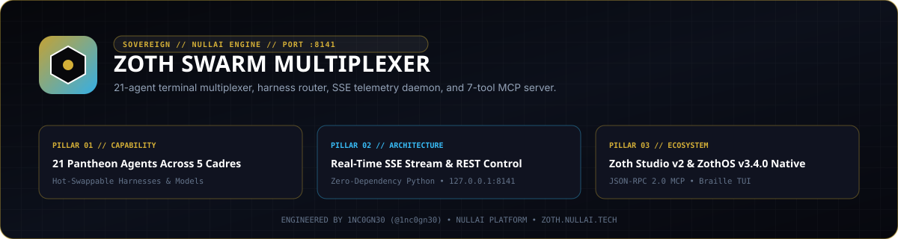

<div align="center">
  
</div>

# Zoth Swarm Multiplexer

`zoth-swarm-multiplexer` is a zero-dependency Python 3 multi-agent terminal multiplexer, AI harness router, Server-Sent Events (SSE) telemetry daemon, and Model Context Protocol (MCP) JSON-RPC 2.0 server. It organizes 21 named agent nodes across 5 operational cadres and listens on loopback port `127.0.0.1:8141`.

- **Zoth Studio v2 Dossier**: [https://zoth.nullai.tech/tools/zoth-swarm-multiplexer](https://zoth.nullai.tech/tools/zoth-swarm-multiplexer)
- **Standalone Loopback Daemon**: `http://127.0.0.1:8141`
- **Support Development**: [https://buy.stripe.com/3cIfZg27PdKo2D64Ocfw40X](https://buy.stripe.com/3cIfZg27PdKo2D64Ocfw40X)

---

## Overview

`zoth-swarm-multiplexer` provides a single control plane for inspecting, routing, and broadcasting commands across 21 agent terminals without third-party Python dependencies.

Key capabilities:
- **21-Agent Topology Across 5 Cadres**:
  - `Architects` (6): `AZOTH`, `NEXUS`, `VIGIL`, `MERCURY`, `GHOSTBYTE`, `ATHENA`
  - `Code` (4): `CHRONOS`, `DRACO`, `IGNIS`, `KAI`
  - `Security` (4): `LYCAN`, `ONYX`, `SCORPIUS`, `PIXEL-SHIBA`
  - `Creative` (3): `KITSUNE`, `LEVIATHAN`, `AQUILA`
  - `Swarm` (4): `KRAKEN`, `AETHER`, `PIXEL-NEKO`, `RADICAL-MINION`
- **Runtime Harness & Model Switching**: Reassign any agent node's harness (`hermes-agent`, `agy`, `codex`, `claude-code`, `opencode`, `ollama`), target model, and working directory (`pwd`) at runtime via CLI, REST, or MCP.
- **SSE Event Stream**: Live `text/event-stream` push feed (`/stream`, `/api/swarm/stream`) broadcasting command dispatches, log lines, harness switches, and heartbeat frames.
- **STDP Memory Sync Hook**: Synchronizes agent synapse counters and memory scores via `/memory/sync` (`swarm_sync_memory`).
- **7-Tool MCP Server**: Native `stdio` server (`mcp_server.py`, protocol `2024-11-05`) for Claude Code, Hermes Agent, Cursor, and OpenCode.

---

## Architecture

| Component | Path | Responsibility |
| :--- | :--- | :--- |
| Server Launcher | `server.py` | Launches `SwarmHTTPHandler` on `127.0.0.1:8141` (`--port` override supported) |
| Core Engine & Daemon | `swarm_daemon.py` | `SwarmMultiplexerEngine` state machine, REST handler, and SSE broadcaster |
| CLI Client | `swarm_cli.py` | Terminal CLI (`status`, `exec`, `broadcast`, `switch`, `daemon`) with `--json` output and automatic offline engine fallback |
| MCP Server | `mcp_server.py` | JSON-RPC 2.0 `stdio` server exposing 7 swarm management tools |
| Web Workstation | `index.html` / `public/index.html` | Browser dashboard for filtering cadres, dispatching commands, and tailing SSE logs |
| Node / Electron Wrapper | `bin/zoth-swarm.js` | Unified CLI/Web/Electron launcher (`zoth-swarm`) |
| Braille TUI | `bin/zoth-swarm-multiplexer-tui` | ZothOS v3.4.0 Unicode `U+2800` 2x4 Braille terminal status display |

---

## Quickstart

Clone the repository and install in editable mode (or invoke directly with Python 3.9+):

```bash
git clone https://github.com/1nc0gn30/zoth-swarm-multiplexer.git
cd zoth-swarm-multiplexer
pip install -e .

# Start the standalone HTTP & SSE daemon on http://127.0.0.1:8141
python3 server.py
```

Inspect agent state from another terminal:

```bash
python3 swarm_cli.py status
python3 swarm_cli.py status --cadre Security --json
```

---

## CLI & MCP Usage

### Command-Line Interface (`swarm_cli.py` / `zoth-swarm`)

If the HTTP daemon on `127.0.0.1:8141` is offline, `swarm_cli.py` automatically falls back to an in-process `SwarmMultiplexerEngine` instance.

```bash
# Matrix view or JSON dump of all 21 agents (or a single cadre)
python3 swarm_cli.py status --cadre Architects
python3 swarm_cli.py --json

# Execute a command on a specific agent node
python3 swarm_cli.py exec --agent AZOTH "status"
python3 swarm_cli.py exec --agent MERCURY "git status" --json

# Broadcast a directive across all 21 agents or a specific cadre
python3 swarm_cli.py broadcast --cadre Security "status"

# Hot-swap harness and inference model on an agent node
python3 swarm_cli.py switch --agent MERCURY --harness hermes-agent --model hermes-3:70b

# Start the HTTP & SSE daemon explicitly via CLI
python3 swarm_cli.py daemon --port 8141
```

### Model Context Protocol (`mcp_server.py`)

Add `zoth-swarm-multiplexer` to your MCP client configuration:

```json
{
  "mcpServers": {
    "zoth-swarm-multiplexer": {
      "command": "python3",
      "args": ["/path/to/zoth-swarm-multiplexer/mcp_server.py"]
    }
  }
}
```

Exposed MCP tools:
- `swarm_list_agents` — List all 21 agent nodes (optional `cadre` filter: `All`, `Architects`, `Code`, `Security`, `Creative`, `Swarm`).
- `swarm_execute` — Execute `command` on `agent_id`.
- `swarm_broadcast` — Broadcast `command` across `All` or a specific `cadre`.
- `swarm_switch_harness` — Update `harness` and/or `model` on `agent_id`.
- `swarm_set_pwd` — Update working directory `pwd` on `agent_id`.
- `swarm_get_logs` — Fetch the most recent `limit` log entries for `agent_id`.
- `swarm_sync_memory` — Trigger synaptic memory score synchronization for `agent_id` or all 21 agents.

---

## REST & SSE Endpoints

When running `python3 server.py` on `http://127.0.0.1:8141`:

| Method | Path | Body / Query | Description |
| :--- | :--- | :--- | :--- |
| `GET` | `/`, `/index.html` | None | Web multiplexer dashboard |
| `GET` | `/health`, `/status`, `/api/swarm`, `/api/swarm/status` | None | Full 21-agent state snapshot, cadres, harnesses, and recent history |
| `GET` | `/stream`, `/events`, `/api/swarm/stream` | None | Real-time `text/event-stream` SSE feed |
| `GET` | `/archive`, `/api/swarm/archive` | None | Timestamped command execution history |
| `POST` | `/execute`, `/api/swarm/execute` | `{"agent_id":"AZOTH","command":"status"}` | Execute a command on a single agent |
| `POST` | `/broadcast`, `/api/swarm/broadcast` | `{"command":"status","cadre":"Security"}` | Broadcast a command to a cadre or `All` |
| `POST` | `/harness`, `/api/swarm/harness` | `{"agent_id":"MERCURY","harness":"hermes-agent"}` | Switch an agent's execution harness |
| `POST` | `/model`, `/api/swarm/model` | `{"agent_id":"MERCURY","model":"hermes-3:70b"}` | Switch an agent's model identifier |
| `POST` | `/pwd`, `/api/swarm/pwd` | `{"agent_id":"CHRONOS","pwd":"/tmp/work"}` | Update an agent's working directory |
| `POST` | `/memory/sync`, `/api/swarm/memory/sync` | `{"agent_id":"AZOTH"}` (optional) | Reinforce agent memory score and synapse count |

---

## ZothOS & Zoth Studio Integration

- **Zoth Studio v2**: Indexed as `zoth-swarm-multiplexer` at [https://zoth.nullai.tech/tools/zoth-swarm-multiplexer](https://zoth.nullai.tech/tools/zoth-swarm-multiplexer) (`http://127.0.0.1:3000/tools/zoth-swarm-multiplexer`), connecting to `http://127.0.0.1:8141/health` and `/stream`.
- **ZothOS v3.4.0 CLI & Braille TUI**: Available via `/usr/local/bin/zoth-swarm-multiplexer` and `/usr/local/bin/zoth-swarm-multiplexer-tui`:
  ```bash
  zoth-swarm-multiplexer --help
  zoth-swarm-multiplexer status --json
  zoth-swarm-multiplexer-tui --status
  ```

---

## Testing & Verification

Run the 12-test `pytest` suite covering engine initialization, cadre broadcasts, harness/model hot-swapping, PWD updates, memory sync, and MCP JSON-RPC calls:

```bash
python3 -m pytest -q
```

Verify secret hygiene with Gitleaks:

```bash
gitleaks detect --source . --no-banner --redact
```

---

## License

MIT License. Copyright (c) 2026 1nc0gn30 (`@1nc0gn30`, [https://1nc0gn30.si](https://1nc0gn30.si)) & NullAI ([https://nullai.tech](https://nullai.tech)). See [LICENSE](LICENSE).
